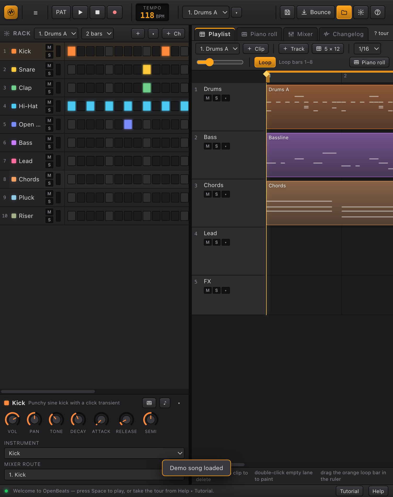

# OpenBeats

**An open-source beatmaking studio for the desktop.** Channel Rack, step sequencer, piano roll, playlist, mixer and a native audio engine — built with Rust + Tauri and a React/Web Audio front end. Linux, Windows and macOS.



> OpenBeats is an independent project. It is *inspired by* the workflow of classic pattern-based DAWs (channel rack → patterns → playlist → mixer); it ships no code, samples, presets or assets from FL Studio or any other commercial DAW.

---

## Download

Installers are built by GitHub Actions and attached to [Releases](https://github.com/blsphmicwillow/OpenBeats/releases).

| Platform | File | Notes |
| --- | --- | --- |
| Linux | `OpenBeats_<version>_amd64.deb` | Debian/Ubuntu. Needs WebKitGTK 4.1 (`libwebkit2gtk-4.1-0`). |
| Linux | `OpenBeats_<version>_amd64.AppImage` | Portable, no install. |
| Windows | `OpenBeats_<version>_x64-setup.exe` | NSIS installer. |
| Windows | `OpenBeats_<version>_x64_en-US.msi` | MSI for managed machines. |
| macOS | `OpenBeats_<version>_x64.dmg` / `_aarch64.dmg` | Intel and Apple silicon. |

Until a release is published you can build from source — see [docs/BUILDING.md](docs/BUILDING.md).

### First run

1. The demo song **Neon Drift** loads automatically. Press **Space** to play.
2. `Ctrl/Cmd + K` opens the command palette — everything is reachable from there.
3. **Help → Tutorial** walks the Rack → Piano roll → Playlist → Mixer flow.
4. **File → Export** bounces a WAV, optionally loudness-normalised for a streaming target.

---

## Features

### Studio
- **Channel Rack** with step sequencer, per-channel instrument, mixer routing, mute/solo and 12 procedural instrument engines.
- **Piano roll** with draw, select, resize and velocity editing; scale highlighting.
- **Playlist** with pattern and audio clips, track mute/solo, loop region and a snap grid.
- **Mixer** with inserts, sends, buses and a master strip; 8 native effect types (3-band and 10-band EQ, compressor, limiter, reverb, delay, drive, filter).
- **Song / Pattern mode**, metronome, count-in, tempo and swing.
- **Bounce** to 16/24-bit WAV at 44.1 or 48 kHz, with optional mastering targets.

### Writing & mixing assistants (local DSP — no cloud, no accounts)
- **Fix My Mix** — renders the master, measures peak / loudness / crest / stereo width and seven frequency bands, then explains what is fighting for space and applies corrective EQ, compression and a limiter as ordinary effects. A/B compares the corrected chain with the original.
- **Mastering targets** — Spotify (−14 LUFS), Club (−9), SoundCloud (−13), YouTube (−14), applied on bounce with shelf EQ, glue compression and a true-peak-style ceiling.
- **Hum to Melody** — records the microphone, tracks pitch, quantises to the grid and writes notes to the piano roll.
- **Inspire Me** — four-chord progressions by key, scale and mood, with an optional root bass line.
- **Sample tagging** — estimates BPM, brightness and instrument family on import.

### Desktop integration
- Native save/open dialogs and “reveal in folder”.
- **Update checker** against this repository's GitHub Releases, with an in-app banner and a **Changelog** tab.
- Native window chrome, resize handling and platform-aware shortcuts.

### Interface
- **Classic** and **Modern** interface modes over the same theme tokens.
- Built-in themes, including **Glass (dark)** and **Liquid Glass (light)** glassmorphism styles.
- **My theme** editor: colour wheel, HEX field and RGB sliders for every token; import/export theme JSON.
- Command palette, density switch, interface scale, reduced motion, accent override.
- Optional *Studio 2006* throwback theme.

---

## Keyboard

| Action | Shortcut |
| --- | --- |
| Play / stop | `Space` |
| Command palette | `Ctrl/Cmd + K` |
| Save | `Ctrl/Cmd + S` |
| Export WAV | `Ctrl/Cmd + E` |
| New / Open | `Ctrl/Cmd + N` / `Ctrl/Cmd + O` |
| Undo / redo | `Ctrl/Cmd + Z` / `Ctrl/Cmd + Shift + Z` |
| Toggle Song/Pattern | `L` |
| Metronome | `C` |
| Quantise selection | `Q` |
| Duplicate | `Ctrl/Cmd + D` |
| Delete | `Delete` |

The full map is in **Help → Shortcuts**.

---

## Development

Requirements: **Node 20+**, **Rust 1.77+**, and on Linux the Tauri system packages. Full per-OS instructions: [docs/BUILDING.md](docs/BUILDING.md).

```bash
npm install
npm run dev          # browser build at http://localhost:3000
npm run desktop      # Tauri window with hot reload
npm run build        # type-check + production bundle
npm run desktop:build# native binary + installers in src-tauri/target/release/bundle
npm run icons        # regenerate app icons from scripts/make-icons.mjs
```

Repository layout and data flow: [docs/ARCHITECTURE.md](docs/ARCHITECTURE.md).
Theming and the colour editor: [docs/THEMING.md](docs/THEMING.md).
Release/signing process: [docs/BUILDING.md](docs/BUILDING.md#releases).

### Project layout

```
src/
  audio/        Web Audio engine, scheduler, instruments, export, mastering
  components/   Rack, piano roll, playlist, mixer, dialogs, palette, changelog
  lib/          analysis, mastering, theory, tagging, updates, native bridge
  model/        project types and demo song
src-tauri/      Rust shell, capabilities, icons, bundler config
docs/           build, architecture and theming guides
scripts/        icon generation
```

---

## Status and limitations

- Installers are produced by CI. Building them requires the platform SDKs (Xcode on macOS, MSVC on Windows); cross-building installers is not supported.
- The Linux packages built here target Ubuntu 24.04 (glibc 2.39). CI builds on Ubuntu 22.04 for a wider glibc range; rebuild there if you need older distributions.
- The update checker **notifies** and links to the release. Silent in-app installation is prepared but needs a signed Tauri updater key pair (`TAURI_SIGNING_PRIVATE_KEY`, `plugins.updater.pubkey`) — see the build guide.
- The assistants are deterministic local DSP, not a hosted language model. Nothing is uploaded.
- Not implemented yet: stem separation, a WASM wavetable synth, mixer folders, track freeze, PDC, per-clip effects, project snapshots, dockable panels, a spectral editor and a live-performance mode. See [ROADMAP.md](ROADMAP.md).

## Contributing

Issues and pull requests are welcome. Read [CONTRIBUTING.md](CONTRIBUTING.md) first; `npm run build` and a manual smoke test are expected before a PR.

## License

GPL-3.0-or-later. See [LICENSE](LICENSE). The demo song and all instrument presets are original and generated procedurally.
