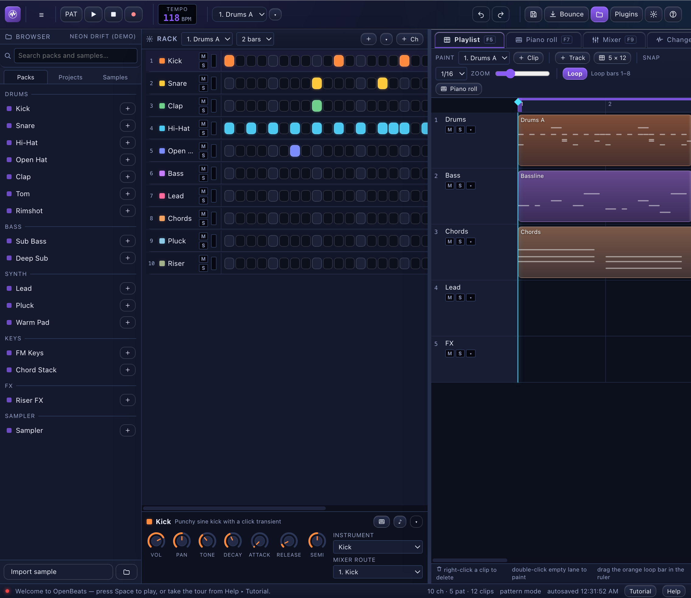
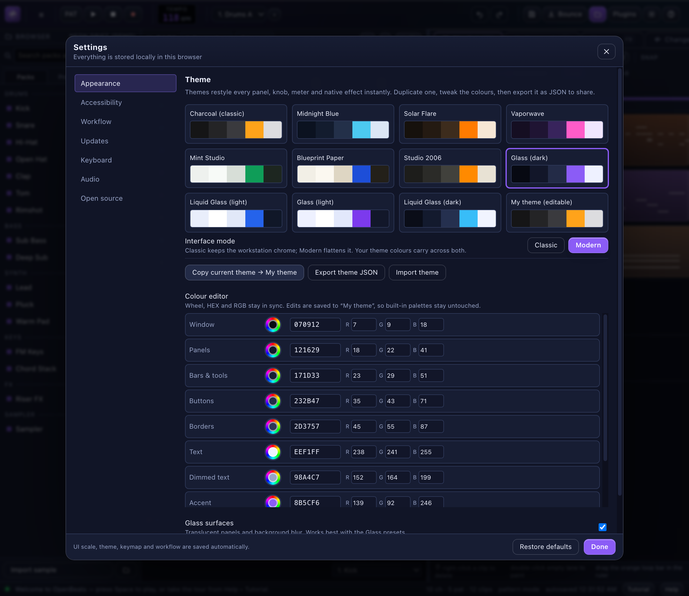

# OpenBeats

**An open-source beatmaking studio for the desktop.** Channel Rack, step sequencer, piano roll, playlist and mixer — built with a Rust/Tauri desktop shell and a React/Web Audio front end. Linux, Windows and macOS.



> OpenBeats is an independent project. It is *inspired by* the workflow of classic pattern-based DAWs (channel rack → patterns → playlist → mixer); it ships no code, samples, presets or assets from any commercial DAW.

## Screenshots


Eleven built-in themes, Classic and Modern chrome, and an editable **My theme** with a colour wheel, HEX and RGB fields:



---

## Audio I/O and workflow highlights

- **Audio Settings tab** lists every input and output device CPAL reports and rebuilds the stream when you choose one.
- **Native auditioning**: Browser samples, channel-rack test notes and the metronome play through a dedicated CPAL preview voice that bypasses the sequencer, so they sound even while the transport is stopped.
- **Community sample packs**: import an OpenBeats manifest pack, an FL-style category folder, a generic one-shot zip or a flat dump; samples are categorised, shown in the Packs and Samples tabs, and summarised in an import report. Zips are bounded against traversal, symlinks, oversized entries and compression bombs. [Supported layouts and limits](docs/IMPORT_PACKS.md).
- **Export that just saves**: native WAV, 24-bit WAV and FLAC encoding plus a bundled MP3 encoder, all behind the native save dialog; OGG and M4A use ffmpeg when installed.
- **A playhead you can move**: drag the playhead to seek native playback in real time, and the playlist and piano roll follow it while playing.
- **Friendly device names** by default, with an opt-in Dev Mode that shows the raw ALSA/PipeWire strings.
- **Linux silence fixed properly**: the picker prefers the PipeWire/PulseAudio bridge, because ALSA's `default` device can route to a null sink; F32/F64/I16/I32/U16 formats are handled and the opened device, rate and latency are logged.
- **Hot-swap and low latency**: a failed device falls back to the system default, and Low-latency mode uses the smallest buffer the device offers with a live latency readout.
- **Master on outputs 1/2, cue on 3/4** for four-channel interfaces, with an independent cue level.
- **True-peak master limiter** with 4× oversampled inter-sample detection, plus Mid/Side inserts, a sidechain dynamic EQ and a `rustfft` spectrum analyser.
- **Smart Humanize** (groove templates, deterministic), **Auto Gain Staging** to -6 dBFS, a rule-based **Melody Generator**, a held-note **Note Arpeggiator**, **Project Health Check**, **Tap Tempo** and **session recovery** every 30 seconds.

---

## Install OpenBeats 1.0.6

Every package is built by GitHub Actions and attached to the
[1.0.6 release](https://github.com/blsphmicwillow/OpenBeats/releases/tag/v1.0.6).
No account is required.

| Platform | Release file | Install |
| --- | --- | --- |
| Arch Linux | `openbeats-bin` (in this repo) | `cd packaging/arch && yay -Bi .` — see below |
| Linux (any) | `OpenBeats_1.0.6_amd64.AppImage` | `chmod +x`, then run it |
| Debian / Ubuntu | `OpenBeats_1.0.6_amd64.deb` | `sudo apt install ./OpenBeats_1.0.6_amd64.deb` |
| Fedora / RPM | `OpenBeats-1.0.6-1.x86_64.rpm` | `sudo dnf install ./OpenBeats-1.0.6-1.x86_64.rpm` |
| Windows 10/11 | `OpenBeats_1.0.6_x64-setup.exe` | Run the installer (or use the `.msi`) |
| macOS (Apple silicon) | `OpenBeats_1.0.6_aarch64.dmg` | Open the DMG and drag OpenBeats to Applications |
| Source | `git clone` | [docs/BUILDING.md](docs/BUILDING.md) |

There is no separate Intel-Mac DMG in 1.0.6; Intel Macs can build from source.
Full per-platform commands, dependencies and troubleshooting are in
[docs/INSTALL.md](docs/INSTALL.md).

### Arch Linux with `yay`

The AUR-ready package lives in [`packaging/arch`](packaging/arch). It installs
the official 1.0.6 AppImage under `/opt/openbeats`, creates
`/usr/bin/openbeats`, and declares the GTK, GStreamer and PulseAudio runtime it needs.

**Install from this repository now** (works without the AUR):

```bash
sudo pacman -S --needed base-devel git

git clone https://github.com/blsphmicwillow/OpenBeats.git
cd OpenBeats/packaging/arch

yay -Bi .
```

`yay -Bi` builds and installs the local `PKGBUILD`; it offers to install any
missing dependency. To install the dependencies yourself first:

```bash
sudo pacman -S --needed gtk3 gstreamer gst-plugins-base gst-plugins-good \
  gst-plugins-bad gst-plugins-ugly gst-libav libpulse alsa-lib \
  libayatana-appindicator librsvg openssl xdg-utils hicolor-icon-theme

# Choose the audio server you actually use:
sudo pacman -S --needed pipewire-pulse   # PipeWire (recommended)
# sudo pacman -S --needed pulseaudio     # PulseAudio instead
```

The package declares `pulse-native-provider`, so `pacman` requires either
`pipewire-pulse` or `pulseaudio`. The AUR package name is `openbeats-bin`. It is
**not published on the AUR yet** (no AUR maintainer key is available in this
build environment), so
`yay -S openbeats-bin` will work only after the maintainer pushes it once:

```bash
ssh -T aur@aur.archlinux.org   # must greet you; needs an AUR SSH key
git clone ssh://aur@aur.archlinux.org/openbeats-bin.git
cp packaging/arch/PKGBUILD packaging/arch/.SRCINFO openbeats-bin/
cd openbeats-bin && git add PKGBUILD .SRCINFO
git commit -m "openbeats-bin 1.0.6" && git push
```

### AppImage (portable Linux)

```bash
curl -L -o OpenBeats.AppImage \
  https://github.com/blsphmicwillow/OpenBeats/releases/download/v1.0.6/OpenBeats_1.0.6_amd64.AppImage
chmod +x OpenBeats.AppImage
./OpenBeats.AppImage
```

If FUSE is unavailable, extract and run instead:
`./OpenBeats.AppImage --appimage-extract-and-run`.

Shelly 3.0.6 and 3.2.1 install this image directly. If an older Shelly reports
`InvalidExe`, update Shelly first, then install FUSE 3 (`sudo pacman -S fuse3`)
and retry; `--appimage-extract-and-run` also bypasses the FUSE mount.

### Debian / Ubuntu

```bash
curl -L -O https://github.com/blsphmicwillow/OpenBeats/releases/download/v1.0.6/OpenBeats_1.0.6_amd64.deb
sudo apt install ./OpenBeats_1.0.6_amd64.deb
openbeats
```

The package declares WebKitGTK 4.1, the full GStreamer audio stack and a
PulseAudio-compatible sound server (`pipewire-pulse` or `pulseaudio`). You
should not need to install audio plugins by hand.

### Fedora

```bash
sudo dnf install ./OpenBeats-1.0.6-1.x86_64.rpm
openbeats
```

The RPM declares the GStreamer audio plugins and a PipeWire-Pulse/PulseAudio
server, so no separate multimedia package list is required.

### Windows

1. Download `OpenBeats_1.0.6_x64-setup.exe` (or the `.msi`) from the release.
2. Run it. Current installers use the WebView2 download bootstrapper: if
   WebView2 is missing, setup downloads it once, so allow network access on the
   first install.
3. SmartScreen may warn because the build is not code-signed: **More info →
   Run anyway**.

### macOS (Apple silicon)

1. Download `OpenBeats_1.0.6_aarch64.dmg` and open it.
2. Drag **OpenBeats** into **Applications**.
3. The DMG is not notarised, so on first launch use **Control-click → Open**, or
   run `xattr -dr com.apple.quarantine /Applications/OpenBeats.app`.

### First run

1. The built-in **Tutorial** project opens automatically. Press **Space** to play.
2. `Ctrl/Cmd + K` opens the command palette — everything is reachable from there.
3. **Help → Tutorial** walks the Rack → Piano roll → Playlist → Mixer flow.
4. **File → Projects…** creates or opens songs; **File → Export** bounces a WAV,
   optionally loudness-normalised for a streaming target.
5. **Help → Learn** walks through every module and a complete first-song path.

---

## FAQ

**Does `yay -S openbeats-bin` work today?**
Not until the package is published to the AUR. The exact same `PKGBUILD` is in
this repository and installs now with `cd packaging/arch && yay -Bi .`.

**No sound on Arch?**
The package declares the GStreamer plugins and requires `pipewire-pulse` or
`pulseaudio`. If you are on an older install, reinstall the package so pacman
pulls the current dependency set, then log out and back in.

**The AppImage does not start.**
Install FUSE 2 (`sudo pacman -S fuse2` on Arch, `libfuse2` on Ubuntu 22.04+) or
run `./OpenBeats.AppImage --appimage-extract-and-run`. The Arch package avoids
FUSE entirely by extracting the AppImage at build time.

**Do I need WebKitGTK or GStreamer installed on Arch?**
The package installs the system GStreamer plugins that WebKit loads for audio,
plus icon and desktop integration. The AppImage bundles WebKitGTK 4.1, GTK 3
and the GStreamer runtime itself; the one thing an AppImage cannot provide is
the system audio server, so PipeWire-Pulse or PulseAudio must be running.

**Can I use VST3, AU or CLAP plugins?**
Hosting is available on Windows/macOS (out-of-process). Loading plugins into
OpenBeats is still not implemented: the `openbeats-plugins` crate can scan, host
and process VST3/CLAP inside the `plughost-helper` sidecar, but inserts are not
routed into the CPAL audio callback yet, so a plugin cannot sit on a mixer strip.
On Linux hosting is disabled because plughost 0.2.1 has no Linux platform layer,
and the app says so instead of failing silently. **View → Plugin library…** still
browses and downloads releases, and the first-party **OpenBeats Gain** proof
plugin is included. The honest status and plan are in
[docs/PLUGINS.md](docs/PLUGINS.md).

**Does it need an account or the internet?**
No. Projects, samples and exports stay local. The only network request is the
optional GitHub update check, which can be disabled in **Settings → Updates**.

**Where are my songs and settings?**
In the app's local WebKit data store for your user account. **File → Projects…**
lists saved songs, and autosave snapshots are restored from the same place. Use
the Projects dialog rather than editing browser-storage files by hand; exports
are written wherever you choose.

**Is there an Intel Mac build?**
Not in 1.0.6. Build from source with the steps in
[docs/BUILDING.md](docs/BUILDING.md).

**How do I update?**
Download the latest release. The in-app banner and **Help → Check for updates…**
notify you and link to GitHub; silent self-update is not enabled because the
release is not signed with a Tauri updater key.

**Is OpenBeats really 1.0.6?**
Yes. 1.0.6 adds named **arrangement markers**: add one at the playhead, drag or
rename it, jump between markers with Alt+Left/Alt+Right, and loop from a marker
to the next one. Markers persist in `.obeats` and round-trip through REAPER
`.rpp` projects. 1.0.6 also adds clip fade handles, a selected-clip inspector,
one-click crossfades and **mixer volume/pan automation lanes** that render into
offline bounces. Markers are arrangement data only and do not change the audio
path. The playlist **audio clips** introduced in 1.0.5 and the new automation
lanes remain **Web Audio only**; native Rust playback is still pending for both.
The version is bumped in the app, Tauri bundle and both Rust crates.

---

## Features

### Studio
- **Channel Rack** with step sequencer, per-channel instrument, mixer routing, mute/solo and 15 procedural instrument engines.
- **Piano roll** with draw, select, resize and velocity editing; scale highlighting.
- **Playlist** with pattern clips, **audio clips** and **named markers**. Drop a WAV/MP3/OGG/FLAC on a lane for an LOD waveform, gain/pan/fades and loop-aware playback. Add markers with F6, drag or rename them, jump with Alt+Left/Alt+Right, and loop from a marker to the next one. Selected clips expose gain, pan and fade controls, with visible fade handles and a one-click crossfade to the next overlapping clip. Copy, cut and paste clips at the playhead with Ctrl/Cmd+C/X/V, and nudge them with Shift+Arrow keys. Track mute/solo, the loop region and the snap grid are unchanged.
  - **Playlist audio clips: Web Audio only in 1.0.6; native Rust playback pending.**
  - Media bytes are cached in the WebView (IndexedDB) with a SHA-256 integrity hash; native app-data persistence is planned for 1.1.
- **Mixer** with inserts, sends, buses and a master strip; 14 built-in effect types (3-band and 10-band EQ, compressor, limiter, reverb, delay, drive, filter, chorus, phaser, bitcrusher, tremolo, auto pan, ring modulator), plus **Web Audio volume/pan automation lanes** with linear, hold and smooth segments and tempo-synced fade-in, tremolo and ducking presets that render into offline bounces.
- **Song / Pattern mode**, metronome, count-in, tempo and swing.
- **Bounce** to 16/24-bit WAV at 44.1 or 48 kHz, with optional mastering targets.

### Native audio engine (Rust)
- **CPAL output** on the desktop: a sample-accurate sequencer, 19 procedural synth voices, and a master chain of 3-band EQ, compressor and limiter run in Rust instead of the WebView. The browser build keeps the Web Audio fallback.
- **Transmitter** transient/sustain split with hold and release detection.
- **Audio Logger** keeps the last 60 seconds of master output and writes it to WAV on demand.
- **Chord detection**, in-key chord suggestions, **Chord Stamp**, and user key labels.
- **Per-clip gain, pan, pitch, stretch and fades**, note names, clip normalisation, and **automation lanes** that can drive any engine parameter.
- **Mixer routing in Rust**: free routing, multiple and pre-fader sends, mute/solo, sidechain ducking, with cycles refused.
- **Editing tools** in Rust: strum, arpeggiate, flam, twelve scales, clip slice/chop/quantize/trim/duplicate, and a modular effect graph.
- **VST3/CLAP hosting** on Windows and macOS through an out-of-process host with crash recovery. On Linux the plugin browser works and the app reports hosting as unavailable.

### Engine split (which engine executes what)
- **Rust native (CPAL):** the transport and sequencer, the 19 procedural voices, and the master chain **EQ → compressor → limiter**. The transmitter meter and audio logger also run natively.
- **Web Audio only:** reverb, delay, drive, filter, chorus, phaser, bitcrusher, tremolo, auto pan and ring modulator inserts, the 10-band graphic EQ, **playlist audio clips**, and **mixer volume/pan automation**. Projects containing automation use the Web Audio transport for playback; native CPAL does not apply those ramps. Offline bounce and Fix My Mix also still render with Web Audio, so **desktop playback and a bounce can diverge** — they are not the same signal path yet.
- **Implemented and tested in Rust, not wired into the CPAL callback:** mixer routing, automation lanes and the modular effect graph. They are reachable over IPC but the audio thread still runs the fixed EQ → compressor → limiter chain.
- **Per-clip pan** is applied per note by the Rust engine; the Web Audio fallback keeps using channel pan. The two engines agree on clip gain, pitch, stretch and fades, but their instrument voices are close rather than sample-identical.

### Writing & mixing assistants (local DSP — no cloud, no accounts)
- **Fix My Mix** — renders the master, measures peak / loudness / crest / stereo width and seven frequency bands, then explains what is fighting for space and applies corrective EQ, compression and a limiter as ordinary effects. A/B compares the corrected chain with the original.
- **Mastering targets** — Spotify (−14 LUFS), Club (−9), SoundCloud (−13), YouTube (−14), applied on bounce with shelf EQ, glue compression and a true-peak-style ceiling.
- **Hum to Melody** — records the microphone, tracks pitch, quantises to the grid and writes notes to the piano roll.
- **Inspire Me** — four-chord progressions by key, scale and mood, with an optional root bass line.
- **Sample tagging** — estimates BPM, brightness and instrument family on import.

### Discord Rich Presence
- Toggle in **Settings → Workflow**. When enabled, Discord shows **“Making a beat..”** with the current project name.
- Rich Presence uses OpenBeats' built-in Discord application ID (`1569568675198140446`), so there is no application ID to create or paste. Switching the toggle off disconnects it.

### Projects
- **Projects** dialog (File → Projects…): open old songs, start a new one, save the current song and delete entries.
- First launch opens a saved **Tutorial** project, not a blank song; the last project is restored after that.

### Interchange with other DAWs
- **Multi-track MIDI import/export** — one track per channel, tempo and program changes, readable by other DAWs including Ableton, Logic, Cubase, Studio One, Bitwig and REAPER.
- **Ableton Live Set import** (`.als`) — gzipped XML, MIDI tracks and clips parsed locally.
- **REAPER project import and export** (`.rpp`) — text project with tracks and MIDI items.
- `.obeats` remains the lossless round-trip; WAV is the audio path. Details and fidelity limits: [docs/EXCHANGE.md](docs/EXCHANGE.md).

### Sounds and drag-and-drop
- **Drop audio files anywhere** on the studio to add sampler channels; dropping several files imports them at once.
- Drop `.mid`, `.als`, `.rpp` or `.obeats` files to open a song, with a visible drop target and a clear import report.
- Imported one-shots are auto-tagged (BPM, brightness, family) and kept in the session sample bank.
- **Import Pack** accepts a folder or `.zip`, recognises OpenBeats manifests and FL-style `Kicks/`/`Snares/` folders, and reports every skipped or corrupt file. FL `.fxp`/`.fst`/`.flp` files are metadata-only; that limitation is spelled out in [docs/IMPORT_PACKS.md](docs/IMPORT_PACKS.md).

### Plugin library
- **View → Plugin library…** (or the **Plugins** button) lists community VST3/CLAP releases from the GitHub-backed registry in [`plugins/registry.json`](plugins/registry.json), with vendor-style category filtering.
- Original instruments and effects include **Glass Keys** (bright inharmonic bell), **Velvet Choir** (additive formant pad) and **FM Bass** (two-operator sine bass), all available in both engines, plus Web Audio **Chorus**, **Phaser**, **Bitcrusher**, **Tremolo**, **Auto Pan** and **Ring Mod** inserts. The first-party **OpenBeats Gain** proof plugin is built in [`plugins/openbeats-gain`](plugins/openbeats-gain); its release archive contains both `.clap` and `.vst3` bundles.
- Download links open the publisher's GitHub Release. There is no silent install and no fake host: **loading plugins into OpenBeats is still not implemented in 1.0.6**.
- Community submissions go through [the plugin submission form](.github/ISSUE_TEMPLATE/plugin-submission.yml); `npm run plugins:check` validates the registry.

### Desktop integration
- Native save/open dialogs and “reveal in folder”.
- **Autosave** on a 2/5/10/15/30/60-minute timer (or Never), a final snapshot on window close, automatic restore after a crash, and **Save now** in Settings → Workflow.
- **Update checker** against this repository's GitHub Releases, with an in-app banner, **Help → Check for updates…**, and a **Changelog** tab.
- Native window chrome, resize handling and platform-aware shortcuts.

### Interface
- **Classic** and **Modern** interface modes over the same theme tokens.
- Startup splash with a short, synthesized ding; the chime can be switched off in **Settings → Workflow**.
- Built-in themes, including **Glass (dark)** and **Liquid Glass (light)** glassmorphism styles.
- **My theme** editor: colour wheel, HEX field and RGB sliders for every token; import/export theme JSON.
- **OpenBeats Learn** from **Help ▸ Learn**: a lazy-loaded, offline walkthrough of every module (rack, piano roll, playlist, mixer, browser, bounce) plus a first-song path. Per-module progress is stored on the device; there are no accounts or network calls.
- Command palette, density switch, interface scale, accent override.
- **Accessibility**: screen-reader labels and states, keyboard-operable knobs and faders, ARIA live hints, a skip link, reduced motion, reduce transparency, high contrast, visible focus rings, scaling and hint toggles.
- **Updates** tab: opt out of automatic launch checks entirely, or check manually at any time.
- Optional *Studio 2006* throwback theme.

---

## Keyboard

| Action | Shortcut |
| --- | --- |
| Play / stop | `Space` |
| Command palette | `Ctrl/Cmd + K` |
| Save | `Ctrl/Cmd + S` |
| Export WAV | `Ctrl/Cmd + E` |
| New / Open | `Ctrl/Cmd + N` / `Ctrl/Cmd + O` |
| Undo / redo | `Ctrl/Cmd + Z` / `Ctrl/Cmd + Shift + Z` |
| Toggle Song/Pattern | `L` |
| Metronome | `C` |
| Add arrangement marker | `F6` |
| Previous / next marker | `Alt+Left` / `Alt+Right` |
| Quantise selection | `Q` |
| Duplicate | `Ctrl/Cmd + D` |
| Copy / cut / paste clip | `Ctrl/Cmd + C` / `X` / `V` |
| Nudge clip | `Shift + Arrow keys` |
| Delete | `Delete` |

The full map is in **Help → Shortcuts**.

---

## Development

Requirements: **Node 20+**, **Rust 1.77+**, and on Linux the Tauri system packages. Full per-OS instructions: [docs/BUILDING.md](docs/BUILDING.md).

```bash
npm install
npm run dev          # browser build at http://localhost:3000
npm run desktop      # Tauri window with hot reload
npm run build        # type-check + production bundle
npm run desktop:build# native binary + installers in src-tauri/target/release/bundle
npm run icons        # regenerate app icons from scripts/make-icons.mjs
npm run plugins:check # validate plugins/registry.json
npm run plugins:fetch # resolve GitHub Releases into plugins/registry.lock.json
```

Repository layout and data flow: [docs/ARCHITECTURE.md](docs/ARCHITECTURE.md).
Theming and the colour editor: [docs/THEMING.md](docs/THEMING.md).
The glass design review (glassmorphism vs Liquid Glass): [docs/GLASS.md](docs/GLASS.md).
DAW interchange matrix: [docs/EXCHANGE.md](docs/EXCHANGE.md).
Plugin support status and roadmap: [docs/PLUGINS.md](docs/PLUGINS.md).
Native Rust/CPAL audio engine: [docs/RUST_AUDIO.md](docs/RUST_AUDIO.md).
Feature parity reference: [docs/FEATURE_PARITY.md](docs/FEATURE_PARITY.md).
Studio architecture and remaining gaps: [docs/STUDIO_ARCHITECTURE.md](docs/STUDIO_ARCHITECTURE.md).
Release/signing process: [docs/BUILDING.md](docs/BUILDING.md#releases).

### Project layout

```
src/
  audio/        Web Audio engine, scheduler, instruments, export, mastering
  components/   Rack, piano roll, playlist, mixer, dialogs, palette, changelog
  lib/          analysis, mastering, theory, tagging, updates, native bridge
  model/        project types and demo song
src-tauri/      Rust shell, capabilities, icons, bundler config
plugins/        registry, submission guide and OpenBeats Gain example
  openbeats-gain/  Rust VST3 + CLAP proof plugin
docs/           build, architecture and theming guides
scripts/        icon generation and plugin validation/fetching
```

---

## Status and limitations

- Installers are produced by CI. Building them requires the platform SDKs (Xcode on macOS, MSVC on Windows); cross-building installers is not supported.
- The Linux packages built here target Ubuntu 24.04 (glibc 2.39). CI builds on Ubuntu 22.04 for a wider glibc range; rebuild there if you need older distributions.
- The update checker **notifies** and links to the release. Silent in-app installation is prepared but needs a signed Tauri updater key pair (`TAURI_SIGNING_PRIVATE_KEY`, `plugins.updater.pubkey`) — see the build guide.
- The desktop build plays through the **native Rust engine**; the browser build uses Web Audio. The two are not sample-identical yet, and the new mixer/automation graph is not wired into the audio callback.
- **VST3/CLAP hosting** runs out of process on Windows and macOS. It is unavailable on Linux; the plugin browser still works and the app says so plainly.
- The assistants are deterministic local DSP, not a hosted language model. Nothing is uploaded.
- Not implemented yet: stem separation, a WASM wavetable synth, mixer folders, track freeze, PDC, per-clip effects, project snapshots, dockable panels, a spectral editor and a live-performance mode. See [ROADMAP.md](ROADMAP.md).

## Contributing

Issues and pull requests are welcome. Read [CONTRIBUTING.md](CONTRIBUTING.md) first; `npm run build` and a manual smoke test are expected before a PR.

## License

GPL-3.0-or-later. See [LICENSE](LICENSE). The demo song and all instrument presets are original and generated procedurally.
